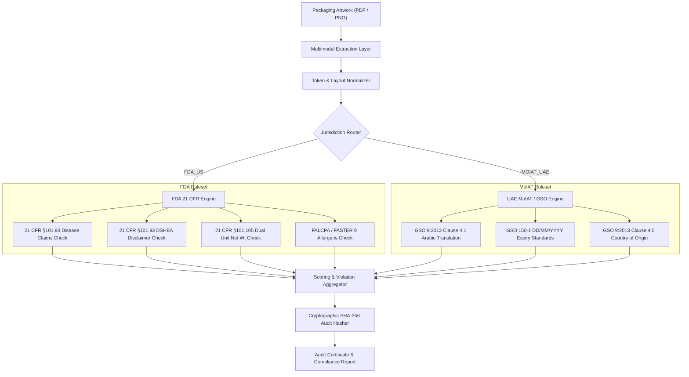

# Multimodal Regulatory Packaging & Label Compliance Auditor
### Deterministic Vision & Rules Engine for FDA (21 CFR) and UAE MoIAT Standards

[](https://github.com/NoorSiddiquiDubai/multimodal-compliance-auditor/actions/workflows/ci.yml)
[]()
[]()
[]()
[]()
[](https://linktr.ee/noorsiddiqui)

---

## 🏛️ Executive Summary

Product recall, customs seizure, and FDA warning letters cost wellness, supplement, and CPG manufacturers hundreds of thousands of dollars each year. Generic LLMs cannot be trusted with regulatory enforcement because they hallucinate permissive interpretations and cannot produce auditable, deterministic citations.

The **Multimodal Regulatory Packaging & Label Compliance Auditor** solves this with a two-tier hybrid architecture:
1. **Multimodal Extraction Layer:** Ingests vector packaging artwork (PDF, PNG, JPG), extracting layout hierarchies, text tokens, and panel regions.
2. **Deterministic Regulatory Engine:** Evaluates extracted tokens against hardcoded statutory requirements under **US FDA 21 CFR Part 101** and **UAE MoIAT GSO 9:2013**, generating cryptographically verifiable SHA-256 compliance audit certificates.

---

## 📐 System Architecture



---

## ⚖️ Regulatory Standards Enforced

### 1. United States — FDA 21 CFR Part 101
* **§101.93(g) Disease Claims Prohibition:** Instant critical rejection on unauthorized curative, mitigation, or diagnostic disease claims.
* **§101.93(c) Mandatory DSHEA Disclaimer:** Enforces verbatim inclusion of the DSHEA statutory disclaimer for all dietary supplements.
* **§101.105 Net Quantity of Contents:** Enforces dual-unit declaration (US Customary ounces/pounds + Metric grams/milliliters) in the bottom 30% of the Primary Display Panel (PDP).
* **FALCPA & FASTER Act Allergen Disclosure:** Validates declaration of major food allergens (`milk`, `egg`, `peanuts`, `tree nuts`, `wheat`, `fish`, `crustacean shellfish`, `soy`, and `sesame`).

### 2. United Arab Emirates — MoIAT & GSO Standards
* **GSO 9:2013 Clause 4.1 Arabic Language Mandate:** Automatic critical rejection if Arabic translation is omitted from consumer-facing packaging.
* **GSO 150-1 Production & Expiry Stamping:** Strict Day/Month/Year (`DD/MM/YYYY`) calendar formatting verification.
* **GSO 9:2013 Clause 4.5 Country of Origin:** Mandatory origin declaration for customs clearance.

---

## 🔒 Cryptographic Audit Trail

Every audit run produces a deterministic SHA-256 fingerprint:
$$\text{Audit Hash} = \text{SHA256}(\text{audit\_id} \mathbin{\Vert} \text{label\_id} \mathbin{\Vert} \text{timestamp} \mathbin{\Vert} \text{status} \mathbin{\Vert} \text{violations\_fingerprint})$$

This prevents post-audit tampering and gives quality assurance teams, customs brokers, and legal counsel an immutable verification token.

---

## 🚀 Quickstart & Local Execution

### 1. Run Unit Tests (100% Pass Rate)
```bash
python -m unittest discover -s tests -p "test_*.py" -v
```

### 2. Run API Locally
```bash
pip install -r requirements.txt
uvicorn app.main:app --reload --port 8000
```
Open API Docs: `http://localhost:8000/docs`

### 3. Run with Docker Compose
```bash
docker-compose up --build -d
```

---

## How to Run

### Install dependencies
```bash
pip install -r requirements.txt
```

### Run tests
```bash
pytest --tb=short
```

### Run the API locally
```bash
uvicorn app.main:app --reload --port 8000
```

### Run with Docker
```bash
docker build -t multimodal-compliance-auditor .
docker run -p 8000:8000 multimodal-compliance-auditor
```

---

## Enterprise Inquiries & Production Deployment

For enterprise integrations, bespoke ruleset engineering, and high-throughput label inspection pipelines:
* **Architect:** Noor Siddiqui (Acting CTO & Sovereign Systems Architect)
* **Master Profile & Direct Bookings:** [linktr.ee/noorsiddiqui](https://linktr.ee/noorsiddiqui)
* **Fixed-Price Service Package:** Available on [Contra](https://contra.com/noorsiddiqui)
